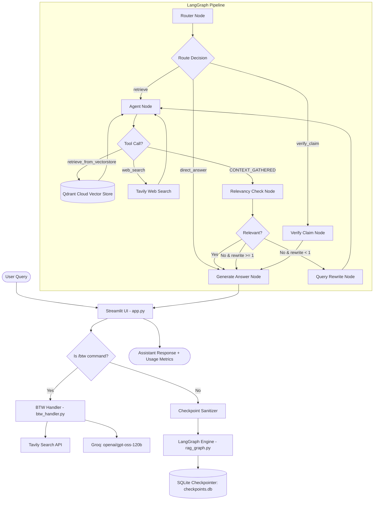

# 📚 Papeer — AI Research Paper Assistant

Papeer is an AI-powered research assistant built with **Streamlit**, **LangChain**, and **LangGraph**. It enables researchers, students, and practitioners to interact with research papers through evidence-grounded Q&A, verify scientific claims against the latest literature using web and arXiv search, and query general knowledge without polluting research contexts.

---

## 🌟 Capabilities & Features

Only features that are fully implemented in the codebase are listed below:

- **Multi-Source Document Ingestion**:
  - Local document parsing (PDF, TXT, Markdown) using `PyPDFLoader` and `TextLoader`.
  - Direct web scraping from URLs via `WebBaseLoader`.
  - Academic paper ingestion directly from **ArXiv** using paper ID or title search via the `arxiv` client.
  - Recursive chunking with configurable overlap (`RecursiveCharacterTextSplitter`, chunk size 1000, overlap 200).
- **Graph-Orchestrated Retrieval-Augmented Generation (RAG)**:
  - Core engine powered by **LangGraph** StateGraph state machine (`backend/rag_graph.py`).
  - Dynamic query routing: classifies requests into `retrieve` (paper-based / time-sensitive Q&A), `verify_claim` (fact-checking), or `direct_answer` (general knowledge).
  - Adaptive retrieval loop: agent node dynamically adjusts search queries, chooses between vector search and web search, evaluates chunk relevancy, and optionally rewrites queries if initial retrieval is insufficient.
- **Evidence-Grounded Answers with Source Attribution**:
  - Synthesizes answers strictly from retrieved paper passages and metadata.
  - Deduplicates chunks and cites source titles and URLs.
  - If retrieved evidence is insufficient, terminates gracefully with a clear message rather than generating unsupported answers.
- **Live Web & arXiv Claim Verification**:
  - Dedicated fact-checking pipeline (`verify_claim` route).
  - Concurrently queries the live web and `site:arxiv.org` via Tavily to detect whether a paper's claim has been superseded, challenged, or updated by more recent research.
  - Outputs a structured verdict and cites up to three superseding papers with direct links.
- **Multi-Turn Conversation Memory**:
  - Graph state and message history persisted per session via SQLite checkpointer (`SqliteSaver` in `checkpoints.db`).
  - Supports follow-up questions referencing earlier context in the conversation.
- **"/btw" Off-Topic Side Channel**:
  - Type `/btw <question>` in the chat (e.g., `/btw What is attention?` or `/btw What is the current price of gold?`).
  - Routes through a dedicated lightweight handler (`backend/btw_handler.py`) with Tavily web search or general knowledge.
  - Completely bypasses the paper vector store and checkpointer, ensuring casual or off-topic queries do not pollute research chat history.
- **Multi-Tenancy & Session Management**:
  - Automatic session naming on the first turn using an LLM title generation prompt (capped at 64 tokens).
  - Isolated vector namespaces in Qdrant (`papeer_{session_id}`) so papers uploaded in one session never bleed into another.
- **Transparent Usage & Quota Breakdown**:
  - Displays real-time per-turn API token metrics, latencies, and search counts in a Streamlit expander beneath each assistant response.

---

## 🏗️ Architecture & Technology Stack



### Core Technologies
- **Frontend / Application Layer**: [Streamlit](https://streamlit.io/) (`app.py`).
- **Graph Orchestration**: [LangGraph](https://github.com/langchain-ai/langgraph) (`langgraph==1.1.10`, `langgraph-checkpoint-sqlite==3.0.3`).
- **Production LLM**: [Groq Cloud](https://groq.com/) running **`openai/gpt-oss-120b`** (120-billion parameter open-weights model).
- **Text Embeddings**: Google Gemini **`gemini-embedding-2`** (768 dimensions), wrapped with `TrackingCacheBackedEmbeddings` over a local file store (`./embedding_cache/`).
- **Vector Database**: [Qdrant Cloud](https://qdrant.tech/) via `langchain-qdrant` with cosine similarity search.
- **Web & Academic Search**: [Tavily Search API](https://tavily.com/) for general web queries and arXiv literature discovery.
- **Structured Data & Output Parsing**: [Pydantic v2](https://docs.pydantic.dev/) schemas (`RouterDecision`, `RelevancyDecision`, `ClaimVerificationResult`, `BtwRouteDecision`).

---

## 🛠️ Development Work Completed

### Phase 1: Production API Usage Monitoring
- **`backend/usage_tracker.py`**: Implemented `QueryUsageTracker`, a LangChain `BaseCallbackHandler` registered through ambient Python `contextvars`.
- **Groq LLM Tracking**: Captures exact prompt tokens, completion tokens, total tokens, model name, call count, latency (ms), and errors across standard, streaming, tool-calling, and structured-output invocations.
- **Gemini Embedding Tracking**: Custom `TrackingCacheBackedEmbeddings` in `backend/vector_store.py` tracking query cache hits/misses, document chunk hits/misses, actual Gemini API calls, and estimated embedded token counts.
- **Qdrant & Tavily Instrumentation**: Tracks search call counts, chunk counts, latency, and failures.
- **UI Exposure**: `render_usage_breakdown()` renders metric cards and markdown tables in Streamlit, persisted in `st.session_state` across reruns.

### Phase 2: Production Quota Protection & Reliability
- **Output-Token Budget**: Added `GROQ_MAX_OUTPUT_TOKENS` (default `1024`, override via `.env`), applied to all `ChatGroq` instances via `create_production_llm()`. Session renaming is capped at 64 tokens.
- **Per-Query Call Ceiling**: Added `MAX_QUERY_LLM_CALLS` (default `5`, override via `.env`). Prevents runaway graph loops across agent, retrieval, relevancy, and query-rewrite nodes.
- **Context-Sufficiency Routing**: If the query call budget is exhausted:
  - If relevant documents exist: formats retrieved passages directly as an evidence-only fallback without spending extra LLM tokens.
  - If context is insufficient: terminates gracefully with a helpful message, making **0 additional LLM calls**.
- **Restricted Retry & Circuit-Breaker Filter**: Patched the private `_should_retry` transport method on production Groq client instances:
  - HTTP 429 (Rate Limit): **Zero retries** (aborts immediately to prevent quota thrashing).
  - HTTP 401 & 403 (Authentication/Permissions): **Zero retries**.
  - Transient HTTP 500, 502, 503, 504, 408: **At most 1 retry** (`max_retries=1`).
  - Isolated strictly to production LLM instances; does not alter standard `BaseClient` behavior globally.
- **Interrupted Tool-Call Checkpoint Recovery**: Implemented `sanitize_checkpoint_messages(graph, config)` in `backend/rag_graph.py`. Detects unmatched `tool_calls` left behind by network disconnects or process restarts and appends synthetic `ToolMessage`s (`"[Execution Interrupted]..."`) to `checkpoints.db`, preventing HTTP 400 validation crashes on subsequent user turns while preserving full conversation history.
- **Graceful Error Handling**: `format_user_error_message(exc)` translates raw exceptions into clean user notices (rate limits, timeouts, service outages) without exposing API keys, system prompts, or stack traces.

---

## ⚡ API Quota Challenges & Lessons Learned

During development, we encountered rapid quota exhaustion on Groq's on-demand free tier. Analyzing this led to key architectural insights:

### Production Usage vs. Evaluation Judge Usage
The system interacts with Groq in two fundamentally different ways:

| Dimension | Production Application Usage | Evaluation Judge Usage (DeepEval) |
| :--- | :--- | :--- |
| **Model** | `openai/gpt-oss-120b` (120B params) | `llama-3.3-70b-versatile` (70B params) |
| **Call Frequency** | 1–5 calls per user query (capped) | ~8–14 judge calls per single test case |
| **Batch Multiplier** | Single user turn at a time | 10 cases × 5 metrics = **~80 to 140 judge calls** |
| **Output Token Limit** | 1024 tokens (default) | 4096 tokens (default, for JSON schemas) |
| **Purpose** | Answering research queries | Automated scoring of Faithfulness, Relevancy, Precision |

### Why Unconstrained Evaluation Exhausts Free-Tier Quotas
DeepEval computes metrics by breaking evaluation into multiple sequential LLM prompts (e.g., Faithfulness extracts statements, searches for context support, checks contradictions, and calculates a verdict). Running a 10-case benchmark across 5 metrics generates an estimated **80 to 140 judge requests**. Under Groq's free-tier rate limits (30 RPM, 14,400 RPD, and 8,000 TPM), batch evaluation rapidly exhausts the per-minute token allocation.

### TPM Limits vs. Call Ceilings: Real Smoke-Test Evidence
A per-query call ceiling (`MAX_QUERY_LLM_CALLS = 5`) bounds the *number of invocations*, but does not limit *tokens per minute (TPM)*. In our live smoke test:
1. **Turn 1 (Paper Q&A)**: Successfully executed 5 Groq calls, retrieving 20 chunks. It consumed **6,798 prompt tokens** and **1,388 completion tokens** (total: 8,186 tokens across ~11 seconds).
2. **Turn 2 (Claim Verification)**: Began immediately after Turn 1. Because Groq's on-demand sliding window had only cleared ~1,600 tokens, requesting 2,016 tokens triggered an HTTP 429:
   ```text
   RateLimitError: Rate limit reached for model `openai/gpt-oss-120b` on tokens per minute (TPM): Limit 8000, Used 6356, Requested 2016. Please try again in 2.79s.
   ```
3. **Protection in Action**: The application caught the 429 immediately, did **not** retry or thrash, and resumed cleanly once the 5-second sliding window expired.

> **Important Takeaway**: Quota protection mechanisms prevent runaway loops, token waste, and database corruption, but they cannot bypass physical provider rate limits. On free tiers, queries with large context windows must be spaced apart to respect TPM limits.

---

## 📊 Evaluation Metrics & Strategy Decisions

To prevent evaluation from draining quota needed for production testing, we revised our metric strategy:

| Metric | Purpose | Current Decision | Rationale |
| :--- | :--- | :--- | :--- |
| **Faithfulness** | Checks whether claims in the generated answer are grounded in the retrieved paper context | **Core Metric** | Primary safeguard against LLM hallucinations in scientific Q&A. |
| **Answer Relevancy** | Checks whether the generated answer directly addresses the user's question | **Core Metric** | Ensures the model does not drift or output unhelpful context. |
| **Contextual Precision** | Checks whether relevant retrieved chunks are ranked higher in the context | **Core Metric** | Evaluates the retriever and reranking quality directly. |
| **Contextual Recall** | Checks whether all ground-truth information from the golden answer was retrieved | **Optional Diagnostic** | Highly dependent on ground-truth wording; evaluated selectively during retrieval audits. |
| **Contextual Relevancy** | Measures the proportion of relevant sentences in the retrieved chunks | **Supplementary** | Overlaps significantly with Contextual Precision; omitted from routine runs to save quota. |

### Quota-Efficiency Decision
We prioritized the three core metrics (**Faithfulness**, **Answer Relevancy**, **Contextual Precision**) because they provide the highest signal-to-cost ratio for RAG reliability. Contextual Recall and Relevancy remain supported in `evaluate.py`, but are not run by default.

---

## 📋 Evaluation Status & Current Limitations

We believe in complete transparency regarding evaluation evidence:

### Confirmed Evidence
- **Benchmark Dataset**: 10 golden Q&A pairs stored in `goldens.json` covering architectural, deployment, security, and feature tradeoffs from `Openclaw_Research_Report.pdf`.
- **Pre-Generated Cases**: 10 complete RAG generation cases saved in `evaluation_cases.jsonl` (including `actual_output` and `retrieval_context` generated by `openai/gpt-oss-120b`).
- **Saved Scores**:
  - `case_0`: **Answer Relevancy = 1.00** (Passed, threshold 0.70; saved in `eval_results.json`).
  - `case_1` through `case_9`: Have generated outputs cached in `evaluation_cases.jsonl`, but do **not** yet have formal saved judge scores in `eval_results.json`.
  - Faithfulness and Contextual Precision do not yet have formal saved scores across the full dataset.

### Code Limitations in `evaluate.py`
- **Result Overwrite**: `evaluate.py` currently overwrites `eval_results.json` at the end of a run rather than performing a key-based merge with existing results.
- **No Metric-Level Checkpointing**: The runner does not check if an individual metric has already been scored for a case before sending it to DeepEval.
- **Stale Cache Safeguard**: Because `rag_graph.py` and `vector_store.py` were updated in Phase 1 & 2, running `evaluate.py` requires `--allow-stale` to evaluate existing cached answers without regenerating them with Groq.

> **Status Summary**: The core application logic and safeguards are verified through unit tests and live smoke tests. However, **formal 10-case DeepEval benchmark coverage remains incomplete** due to rate-limit constraints.

---

## 🧪 Testing & Verification

Papeer maintains strict separation between **offline mock tests** and **live API smoke tests**.

### 1. Offline Unit Test Suite (20 Tests — 0 API Calls)
Run with pytest inside the virtual environment:
```bash
pytest tests/test_production_monitoring.py tests/test_quota_safeguards.py -v
```

- **`tests/test_production_monitoring.py`** (10 tests):
  - Normal and structured token extraction from `AIMessage.usage_metadata` and `response_metadata`.
  - Callback propagation across compiled LangGraph nodes.
  - Prevention of duplicate counting on run completion.
  - Gemini embedding cache hit/miss tracking and separation of query vs. document statistics.
  - Tavily search and Qdrant retrieval metric instrumentation.
  - Turn-level and session-level metric isolation.
  - Preservation of usage records across simulated failures.
- **`tests/test_quota_safeguards.py`** (10 tests):
  - Hard enforcement of `MAX_QUERY_LLM_CALLS`.
  - Safe termination with 0 additional LLM calls when context is insufficient.
  - Answer generation when sufficient evidence exists.
  - Rejection of retries on HTTP 429, 401, 403.
  - Single-retry allowance on transient 5xx/408 errors.
  - Output-token budget configuration and fallback logic.
  - Structured output compatibility with token limits.
  - Checkpoint recovery: healing dangling `tool_calls` with synthetic `ToolMessage`s.
  - Usage record preservation and error sanitization.

**Result**: `20 passed, 2 warnings in 6.29s` (100% offline, zero network access required).

### 2. Live Application Smoke Test
Executed against live external services (Groq, Gemini, Qdrant Cloud, Tavily):
1. **Turn 1 (Uploaded Paper Q&A)**: Successfully queried `Openclaw_Research_Report.pdf`, retrieved 20 chunks from Qdrant, bounded at 5 Groq calls, generated detailed synthesized answer.
2. **Turn 2 (Claim Verification)**: Evaluated multi-agent architecture claim via live web and arXiv search, synthesized structured verdict.
3. **Turn 3 (Conversation Follow-Up)**: Successfully resolved follow-up question using multi-turn conversation context from `checkpoints.db` (accumulated 14 messages).
4. **Resilience**: Handled a live Groq TPM 429 event cleanly without thrashing.

---

## ⚙️ Configuration & Setup

### Prerequisites
- Python 3.14 (or >= 3.11)
- [uv](https://github.com/astral-sh/uv) (recommended) or standard `pip`
- Accounts and API keys for:
  - **Groq Cloud** (LLM inference)
  - **Google AI Studio** (Gemini text embeddings)
  - **Tavily AI** (Web and academic search)
  - **Qdrant Cloud** (Vector database)

### Installation
1. Clone the repository:
   ```bash
   git clone https://github.com/your-username/Papeer.git
   cd Papeer
   ```
2. Create and activate a virtual environment:
   ```bash
   uv venv
   .venv\Scripts\activate   # Windows
   # source .venv/bin/activate  # Linux/macOS
   ```
3. Install dependencies:
   ```bash
   uv pip install -r requirements.txt
   ```

### Environment Variables
Create a `.env` file in the project root:

```env
# ── Production Credentials (Required) ──────────────────────────────────────────
GROQ_API_KEY="gsk_..."
GEMINI_API_KEY="AIza..."
TAVILY_API_KEY="tvly-..."
QDRANT_URL="https://your-cluster-url.qdrant.tech:6333"
QDRANT_API_KEY="your-qdrant-key"

# ── Quota & Safeguard Budgets (Optional - Defaults Shown) ──────────────────────
GROQ_MAX_OUTPUT_TOKENS="1024"   # Max completion tokens per Groq call
MAX_QUERY_LLM_CALLS="5"          # Max LLM invocations per graph execution

# ── Evaluation Configuration (Optional - Defaults Shown) ───────────────────────
EVAL_JUDGE_MODEL="llama-3.3-70b-versatile"
EVAL_JUDGE_MAX_TOKENS="4096"
DEEPEVAL_PER_ATTEMPT_TIMEOUT_SECONDS_OVERRIDE="360"
```

### Running the Application
```bash
streamlit run app.py
```
Open `http://localhost:8501` in your browser. Use the sidebar to upload a research paper or load an ArXiv ID, and begin exploring.

---

## 💡 What We Could Do if API Quota Were Not a Constraint

If rate limits and API budgets were not constrained, the following enhancements could be pursued:

1. **Full DeepEval Benchmark Runs**: Continuously evaluate all 5 metrics across all 10 golden cases on every commit.
2. **Dataset Expansion**: Expand `goldens.json` from 10 cases to 50+ diverse research questions across multiple academic domains.
3. **Cross-Judge Benchmarking**: Compare evaluation consensus across multiple frontier judges (e.g. Groq `llama-3.3-70b` vs. Gemini 1.5 Pro vs. GPT-4o).
4. **Hyperparameter Grid Search**: Systematically sweep chunk sizes (500, 1000, 1500), chunk overlap (100, 200, 300), and top-k retrieval (3, 5, 8, 12) to optimize Contextual Precision and Recall empirically.
5. **Continuous Regression Testing**: Automatically trigger full evaluation runs on pull requests to ensure prompt modifications never regress Faithfulness.
6. **Multi-Hop Literature Synthesis**: Allow the retrieval agent to traverse citation graphs across 10+ papers simultaneously.

> *Note: Unlimited quota does not automatically guarantee evaluation validity; prompt clarity, judge calibration, schema reliability, and high-quality ground-truth goldens remain essential.*

---

## 🗺️ Project Status & Roadmap

```
[x] Core RAG Application Architecture (Streamlit + LangGraph + Qdrant + Tavily)
[x] Multi-Source Document Loaders (PDF, Web, ArXiv)
[x] Off-Topic "/btw" Side-Channel Pipeline
[x] Local Embedding File Cache (LocalFileStore)
[x] Phase 1: Production API Usage Monitoring (Tokens, Latency, Searches, Hits/Misses)
[x] Phase 2: Production Quota Protection (Token Budgets, Call Ceilings, Circuit Breaker)
[x] SQLite Checkpoint Recovery for Dangling Tool Calls
[x] Comprehensive Offline Test Suite (20/20 Passed)
[x] Live 3-Turn Smoke Test Verification
[x] Phase 1 + Phase 2 Git Checkpoint Commit (`cbcc88e`)
[ ] Deployment Readiness Audit (Storage, Secrets, Environment)
[ ] Hosting & Persistent Storage Setup (Cloud Run / Streamlit Community Cloud)
[ ] Evaluation Harness Enhancements (Metric-level result caching and merging)
[ ] Full 10-Case DeepEval Benchmark Execution
```

### Immediate Next Steps
1. Verify documentation and Git repository state.
2. Review the deployment-readiness audit (handling SQLite state, Qdrant connectivity, and `.env` in production).
3. Select hosting target and configure deployment containers/scripts.
4. Deploy Papeer and verify live persistence.
